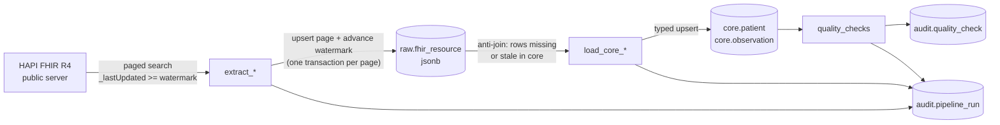

# FHIR Ingest with Apache Airflow

Incremental, idempotent ingestion of FHIR R4 `Patient` and `Observation` resources
from the public [HAPI FHIR](https://hapi.fhir.org/baseR4) test server into PostgreSQL,
orchestrated with Apache Airflow 3, with an audit trail and data-quality checks.

It runs hourly on a small shared VPS next to production websites, so it is also an
exercise in operating a pipeline under tight resource and safety constraints.

## Architecture



DAG `fhir_ingest` (hourly): `extract_patient → load_core_patient`,
`extract_observation → load_core_observation`, then `quality_checks`.

## Data model

| Schema | Table | Purpose |
|---|---|---|
| `raw` | `fhir_resource` | Full resource JSON per `(resource_type, resource_id)`. Allows reprocessing without calling the API again. |
| `core` | `patient`, `observation` | Typed, query-friendly columns. All timestamps normalized to UTC (`timestamptz`). |
| `audit` | `watermark` | Highest source `lastUpdated` already landed, per resource. |
| `audit` | `pipeline_run` | One row per task attempt: status, timing, error, full stats (`jsonb`). |
| `audit` | `quality_check` | Every check result: value, threshold, severity, pass/fail. |

No foreign keys or `CHECK` constraints on purpose: the source is a public test server
with inconsistent data. Quality is **measured** by checks, not enforced on load, so a
single bad record never blocks a batch.

## Key design decisions

- **Idempotent upserts.** `INSERT ... ON CONFLICT DO UPDATE ... WHERE excluded.last_updated > t.last_updated`.
  Re-running never duplicates rows and an older version never overwrites a newer one.
- **Raw first, data never through XCom.** Tasks exchange only small stats; data stays in Postgres.
- **Self-healing transform.** `load_core` processes raw rows that are missing or stale in core
  (anti-join on `last_updated`), so a run that failed halfway is completed by the next one.
- **Source-driven watermark.** The window comes from the last record actually loaded, not from the
  scheduler clock: failed or paused runs are caught up automatically. Results are sorted oldest-first
  and the watermark is advanced in the same transaction as each page, so progress is never lost.
- **Overlap only near the head of the stream.** A 5-minute overlap covers late commits for recent
  data; during backfill it is disabled because it only re-reads the same records (see incidents below).
- **Stall guard.** If a run consumes all its pages without moving the watermark, it fails explicitly
  (`AirflowFailException`, no pointless retries) with a message explaining how to recover.
- **Retries at two levels.** HTTP: `urllib3.Retry` with exponential backoff on connection errors,
  `429` and `5xx`, honouring `Retry-After`. Task: Airflow retries with exponential backoff.
- **Gentle with a shared public server.** Page size and a per-run page cap; initial load limited to
  the last 30 days and completed gradually across hourly runs.
- **Quality checks with severities.** Critical checks fail the run; warnings are recorded only,
  because dirty source data is not a pipeline failure.

| Check | Severity | Rule |
|---|---|---|
| `reconciliation_pending_rows` | critical | raw rows not reflected in core ≤ rows rejected this run |
| `freshness_lag_hours` | critical | watermark lag ≤ 3 h, unless the extract is still catching up |
| `observation_missing_subject_pct` | warning | ≤ 40 % |
| `observation_orphan_patient_pct` | warning | ≤ 50 % |
| `patient_missing_birth_date_pct` | warning | ≤ 50 % |
| `patient_test_data_pct` | warning | ≤ 50 % |

## Evidence from real runs (2026-11-05)

- **Idempotency.** First run: 150 fetched / 150 inserted per resource. Identical re-run:
  150 fetched, **0 inserted, 0 updated, 150 unchanged**, and `load_core` found **0 pending** rows.
- **Incremental continuation.** After the initial load, the next run started exactly at
  `watermark − 5 min`; the overlapping rows (1 Patient, 60 Observations) were absorbed as unchanged.
- **Completeness.** For a fully processed window, the source reported **2,896** Observations and
  raw contained **2,896**.
- **Quality snapshot.** 63.24 % of patients without birth date (warning raised, run not failed),
  9.17 % synthetic test records, 1.7 % observations without subject, 1.8 % with a patient not loaded.

## Incidents found while building it

1. **Driver mismatch.** `PostgresHook.get_conn()` (postgres provider 7.x) returned a non-psycopg2
   connection, and `psycopg2.extras.execute_values` failed on the first page. The failure happened
   before the commit, so nothing was written. Fix: open an explicit psycopg2 connection using only
   the credentials of the Airflow connection.
2. **Watermark stall on a bulk upload.** Someone had uploaded ~2,000 patients within three minutes.
   With a 5-minute overlap, the next run re-read the same 2,000 records (2,000 fetched, 0 inserted)
   and the stall guard failed it explicitly instead of looping silently every hour. Fix: apply the
   overlap only when the watermark is less than one hour old. The following run advanced the Patient
   watermark by 5.5 days with only 4 unchanged rows.
3. **Timestamp ties.** 863 Observations shared the exact same `lastUpdated` (one bulk transaction),
   and a run ended in the middle of that block. Because the next run uses `>= watermark`, it re-read
   the block and completed it; source and target counts were verified to match.

## Running it

Requirements: Docker Engine with the Compose plugin, ~2 GB of free RAM.

```bash
cp .env.example .env            # fill in the secrets (commands inside the file)
chmod 600 .env
mkdir -p logs plugins config
docker compose up airflow-init  # migrates the metadata DB and creates the admin user
docker compose up -d

# FHIR database, role and schemas (inside the same Postgres container)
FHIR_DB_PASSWORD=$(grep '^FHIR_DB_PASSWORD=' .env | cut -d= -f2)
docker compose exec -T postgres psql -U airflow -d airflow -v ON_ERROR_STOP=1 -v pw="$FHIR_DB_PASSWORD" <<'SQL'
CREATE ROLE fhir_etl LOGIN PASSWORD :'pw' NOSUPERUSER NOCREATEDB NOCREATEROLE;
CREATE DATABASE fhir OWNER fhir_etl;
REVOKE ALL ON DATABASE fhir FROM PUBLIC;
SQL
docker compose exec -T postgres psql -U fhir_etl -d fhir -c 'CREATE SCHEMA raw; CREATE SCHEMA core; CREATE SCHEMA audit;'
for f in sql/*.sql; do docker compose exec -T postgres psql -U fhir_etl -d fhir -v ON_ERROR_STOP=1 -1 < "$f"; done
```

The UI listens on `127.0.0.1:8090` only. Unpause `fhir_ingest` and trigger a run.

## Deployment notes

It runs on a 2 vCPU / 3.7 GiB VPS that also serves production websites, so:

- **LocalExecutor**, no Celery/Redis/worker/triggerer; one task at a time.
- **Per-container memory limits** (API 640 MiB, scheduler 768 MiB, DAG processor 384 MiB,
  Postgres 256 MiB). Measured idle footprint: ~680 MiB in total.
- **No public ports.** The UI is bound to localhost and published through **Cloudflare Tunnel**,
  protected by **Cloudflare Access** (one-time PIN, single allowed email). No firewall or reverse-proxy
  changes were needed.
- Docker daemon defaults: log rotation and `"ip": "127.0.0.1"`, so a port published without an
  explicit IP can never bypass the host firewall.

## Project structure

dags/
├── fhir_ingest.py # DAG: orchestration only
└── fhir_lib/
├── client.py # retrying HTTP session + Bundle ‘next’ paging
├── transform.py # pure functions: FHIR JSON -> rows (no I/O)
├── db.py # idempotent upserts, watermark
├── audit.py # per-attempt audit trail
└── quality.py # data-quality checks
sql/ # schema (idempotent DDL)
scripts/explore_fhir.py # read-only exploration of the API used to design the schema
docker-compose.yaml # lightweight Airflow 3 stack

## Limitations and next steps

- Unit tests for `transform.py` and CI (GitHub Actions) are not implemented yet.
- Add a deterministic tie-breaker to the sort (`_sort=_lastUpdated,_id`) and a source-vs-target
  count check as an automated quality check (today it was verified manually).
- Validate the Cloudflare Access JWT in the tunnel as a second layer of protection.
- Only `Patient` and `Observation`; components (e.g. blood pressure) are kept as `jsonb`, and units
  are stored as received (no conversion).